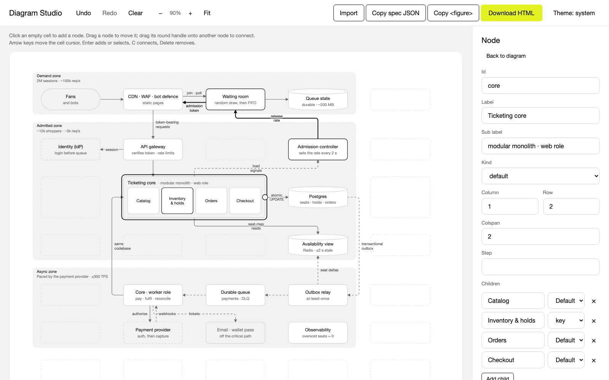
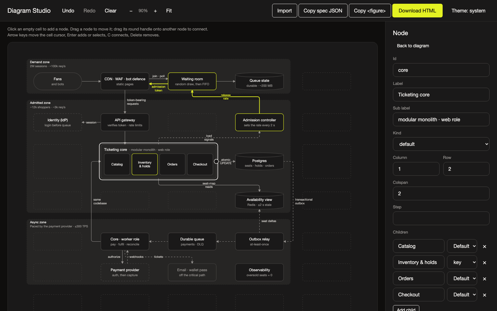

# Diagram Studio

**Live:** [diagram-studio.bibas.dev](https://diagram-studio.bibas.dev) · **Open the studio:** [/app](https://diagram-studio.bibas.dev/app)



A visual editor for [`diagram.js`](vendor/diagram.js) grid diagrams. It is one offline HTML file: open
`diagram-studio.html` in a browser and build a diagram on the grid instead of writing JSON.

It is not a freeform whiteboard. Nodes sit in grid cells and edges run through the gutters, which is what
guarantees no overlapping labels and no edges through boxes. Every change re-renders through the real
engine, and the engine's lint shows under the canvas.

## Use

| Do | Mouse | Keyboard (canvas focused) |
| --- | --- | --- |
| Add a node | click an empty cell | arrows to the cell, Enter |
| Move a node | drag it (it snaps to a cell) | select it, Shift + arrows |
| Connect | drag the round handle (or Shift-drag the node) onto another node | select the source, C, arrows to the target, Enter |
| Select an edge / zone | click the edge / a zone's margin | via the inspector |
| Delete | select, then Delete | Delete |
| Undo / redo | toolbar | ⌘Z / ⇧⌘Z |

The inspector edits everything else: labels, kinds, colspan, container children, edge label / dash / hot /
via, zones, scale (doc or slide) and the interactive flag.

**Export**: copy the `<figure>` block (paste it into any page that inlines `diagram.js`), download a
standalone HTML page, or copy the spec JSON. **Import**: paste a spec, a `<figure>` block or a whole page.
Work autosaves in the browser.

## Screenshots and video

| Light | Dark |
| --- | --- |
|  |  |

Landing page: [docs/screenshots/landing.png](docs/screenshots/landing.png).
Launch video (21 s): [landing/media/brag.mp4](landing/media/brag.mp4), made with
[/brag](https://github.com/latent-spaces/brag) and [Hyperframes](https://hyperframes.heygen.com/). Its source
(storyboard, composition, audio) is in [video/brag-output/](video/brag-output/).

## Develop

```sh
python3 build.py            # src/ + vendor/ → diagram-studio.html
python3 build.py --site     # also site/: landing at /, studio at /app, the single file, media
cd site && vercel deploy --prod   # deploy (site/.vercel links the Vercel project)
python3 build.py --sync     # refresh vendor/ from ~/.agents/design-system first
tests/run.sh                # e2e in headless Chrome: rebuilds the ticketing fixture by mouse, round-trips it
```

`src/store.js` holds state, undo and autosave. `src/canvas.js` renders through the engine and handles the
pointer and keyboard. `src/inspector.js` and `src/io.js` handle the side panel and import/export.

## Credits

- Video music: "Happy Beats / Business Moves Vol. 12" by Sascha Ende, [ende.app](https://ende.app/en), CC BY 4.0.
- Sound effects: [Kenney](https://kenney.nl/), CC0.
